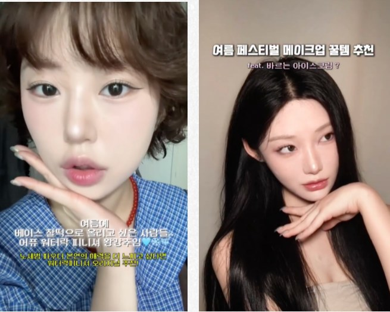
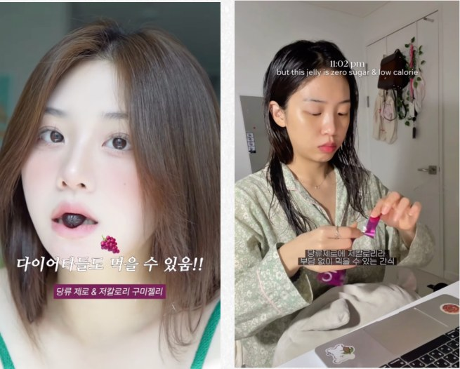
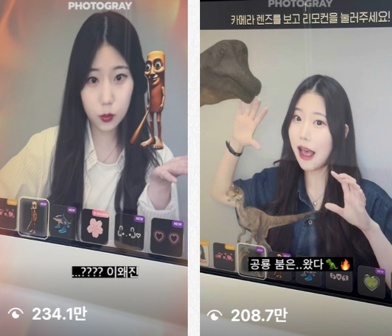
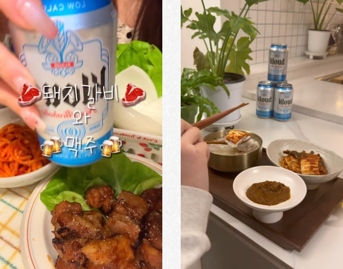
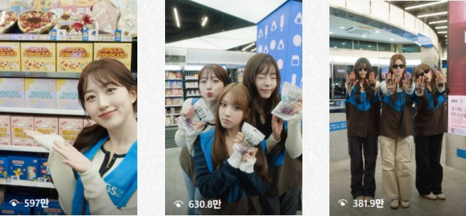
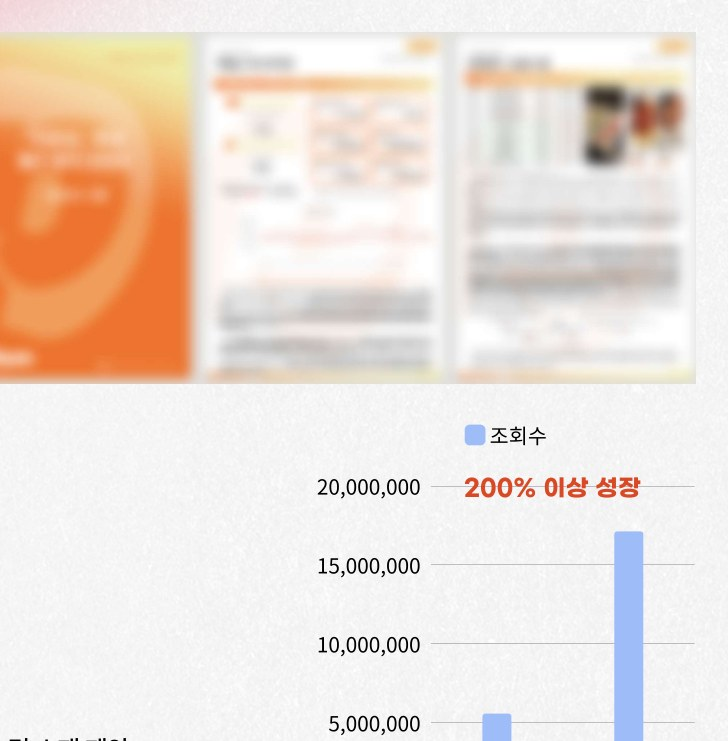
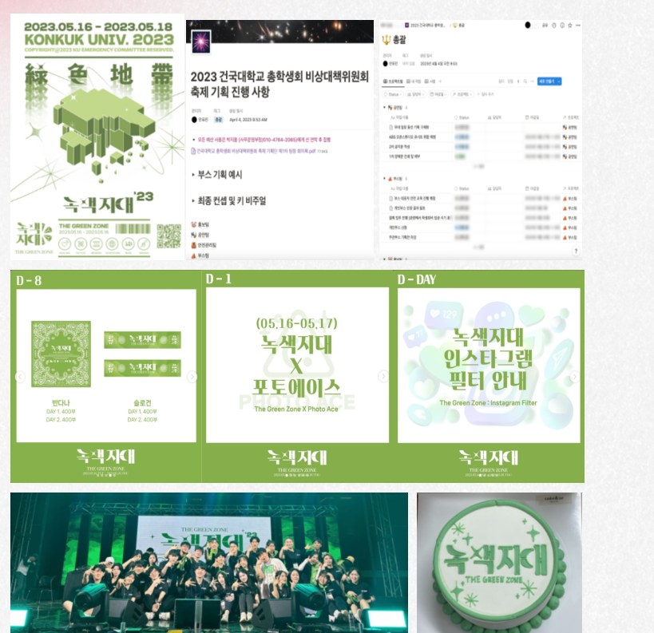

# 안유진 | 인플루언서·콘텐츠 마케팅 포트폴리오

> 제품의 소구점을 콘텐츠로 풀고, 협업을 끝까지 운영하는 마케터 안유진입니다.

뷰티 브랜드 인플루언서 협업과 제품 시딩, 브랜드 숏폼 기획, 크리에이터 채널 분석을 경험했습니다. 브랜드가 전해야 할 내용과 크리에이터가 잘 보여줄 수 있는 방식을 맞추고, 섭외부터 가이드·일정·업로드·성과 보고까지 연결합니다.

## 제가 맡을 수 있는 일

- **인플루언서 협업:** 타깃·제품 특성에 맞는 후보 제안과 리스트업, 섭외·브리핑·일정 조율
- **콘텐츠 기획:** 제품 USP 정리, 네이티브 콘텐츠 가이드, 릴스 기획·촬영·편집
- **캠페인 운영:** 제품 배송·문의 대응·업로드 현황 관리와 성과 보고
- **콘텐츠 분석:** 채널 지표와 콘텐츠 반응을 바탕으로 다음 소재·테마 제안

## Selected Projects

### 01. 어퓨 | 제품의 소구점을 크리에이터의 언어로

BEAUTY · INFLUENCER · 2025.08 · 기여도 80%

**6명 협업 · 조회수 28만+**

**과제**

1020 여성 타깃에게 신제품의 특징을 알리고, 실제 사용 모습을 담은 릴스 콘텐츠로 관심을 확보하는 프로젝트였습니다.

**기획 방향**

브랜드가 전달할 제품 USP와 인플루언서의 기존 콘텐츠 톤이 함께 드러나도록 인플루언서 풀과 콘텐츠 가이드를 구성했습니다.

**담당한 일**

- 제품 특성과 타깃 페르소나에 맞는 인플루언서 후보를 제안하고 리스트를 정리했습니다.
- 브랜드 톤앤매너와 제품 소구점이 자연스럽게 노출되도록 네이티브 콘텐츠 가이드를 작성했습니다.
- 섭외·브리핑·일정 조율·문의 대응을 맡고, 업로드 현황과 콘텐츠 반응을 모니터링했습니다.
- 캠페인 종료 후 성과를 취합해 게재 보고서를 작성했습니다.

**결과**

마이크로 인플루언서 6명과 협업해 누적 조회수 28만 회 이상을 기록했습니다. 기한 내 업로드 완료율은 100%였습니다.

**다음 업무에 적용할 관점**

제품의 장점을 나열하기보다, 크리에이터의 메이크업 맥락 안에서 사용 장면으로 보여주는 가이드가 중요하다고 생각합니다.

[대표 콘텐츠 1](https://www.instagram.com/reel/DNVeMshzfoN/) · [대표 콘텐츠 2](https://www.instagram.com/p/DNarUnRvHpv/)

---

### 02. 올더뮤 | 유가 협업과 100인 시딩을 함께 운영

WELLNESS · PAID / SEEDING · 2025.07–2025.09 · 기여도 60%

**조회수 88.8만+ · 인터랙션 3만+**

**과제**

V컷 뮤신 구미의 인지도 확대를 위해 2534 여성 타깃의 SNS 채널과 셀럽 PPL, 체험단을 함께 운영한 캠페인입니다.

**기획 방향**

메가·마이크로 인플루언서 유가 협업과 100인 시딩을 병행했습니다. 매체 규모와 콘텐츠 특성에 따라 제품 소구점과 전달 방식을 나눠 가이드를 제작했습니다.

**담당한 일**

- 캠페인 목적에 맞는 인플루언서 풀을 제안하고 후보 리스트를 정리했습니다.
- 매체별 특성을 고려해 USP 소구점을 정리하고 콘텐츠 가이드를 제작했습니다.
- 인플루언서 섭외·브리핑·제품 배송·일정 조율 등 캠페인 운영을 담당했습니다.
- 콘텐츠 반응을 모니터링하고 성과와 인사이트를 담은 게재 보고서를 작성했습니다.

**결과**

유·무가 협업 통합 기준 누적 조회수 88.8만 회 이상, 인터랙션 3만 건 이상을 기록했습니다. 업로드 완료율은 100%였습니다.

**다음 업무에 적용할 관점**

서로 다른 규모의 협업을 병행할수록 후보 선정부터 배송·브리핑·업로드까지 같은 기준으로 현황을 관리해야 운영의 완성도를 지킬 수 있습니다.

[대표 콘텐츠 1](https://www.instagram.com/p/DNnR8SSJaKD/) · [대표 콘텐츠 2](https://www.instagram.com/reel/DNsfsmjZra-/)

---

### 03. 포토그레이 | 프레임을 소개하는 대신, 쓰는 장면을 보여주다

SHORT-FORM · CONTENT · 2025.04–2025.05 · 기여도 50%

**업로드 2주 내 조회수 200만 · 인터랙션 17.2만**

**과제**

신규 프레임을 알리고 매장에서 직접 사용해 보고 싶은 마음을 만드는 것이 과제였습니다.

**기획 방향**

이미지 피드형 홍보에서 릴스 영상으로 포맷 전환을 제안했습니다. 프레임의 실제 적용 모습을 직관적으로 보여주는 콘텐츠를 기획했습니다.

**담당한 일**

- Z세대의 콘텐츠 소비 방식을 고려해 릴스 중심의 홍보 방향을 제안했습니다.
- 실제 프레임 사용 모습을 담는 영상 콘텐츠를 기획하고 촬영에 참여했습니다.
- 시각적 후킹을 고려한 썸네일을 기획했습니다.

**결과**

원본 포트폴리오 집계 기준 업로드 2주 내 조회수 200만 회, 인터랙션 17.2만 건을 기록했습니다. 참여 계정은 8.6만 개 이상이었습니다.

**다음 업무에 적용할 관점**

이용 과정을 짧은 영상으로 보여주면 설명만으로 전달하기 어려운 경험을 구체화할 수 있습니다. 매장 방문 전환은 별도 데이터로 확인해야 합니다.

[대표 콘텐츠 1](https://www.instagram.com/reel/DI3X_psyEa1/) · [대표 콘텐츠 2](https://www.instagram.com/reel/DJn_NwiSLoM/)

---

### 04. 클라우드 | 76명의 콘텐츠가 일정 안에 완성되도록

SEEDING · CAMPAIGN OPERATIONS · 2025.12–2026.01 · 기여도 70%

**76명 협업 · 조회수 114만+**

**과제**

논알콜 신제품의 인지도를 높이기 위해 제품의 핵심 타깃과 맞는 나노 인플루언서 협업을 진행했습니다.

**기획 방향**

음식과 함께 즐기는 제품의 특성을 살리고, 요리 콘텐츠 트렌드를 접목한 네이티브 콘텐츠 가이드를 구성했습니다.

**담당한 일**

- 타깃에 맞는 인플루언서 후보를 제안하고 협업 리스트를 작성했습니다.
- 요리 콘텐츠 트렌드와 제품 사용 맥락을 연결한 콘텐츠 가이드를 수립했습니다.
- 인플루언서 76명의 섭외·일정 조율·커뮤니케이션을 관리했습니다.
- 업로드 현황과 반응을 모니터링하고 게재 보고서를 작성했습니다.

**결과**

나노 인플루언서 76명과 협업해 누적 조회수 114만 회 이상, 인터랙션 1.4만 건 이상을 기록했습니다. 업로드 완료율은 100%였습니다.

**다음 업무에 적용할 관점**

협업 인원이 많아질수록 개별 커뮤니케이션의 정확성이 중요합니다. 진행 상태와 기한을 명확히 관리하는 운영 역량을 뷰티 시딩에도 적용할 수 있습니다.

[대표 콘텐츠 1](https://www.instagram.com/p/DTqEhmwk3T1/) · [대표 콘텐츠 2](https://www.instagram.com/p/DTChdWeAUct/)

---

### 05. GS 콘텐츠 | 팬덤과 숏폼 문법을 브랜드 메시지에 연결

BRANDED CONTENT · OWNED MEDIA · 2025.01–2025.04 · 기여도 GS25 캠페인 30% / GS포스트박스 원본 미기재

**콘텐츠 기획 참여 · 촬영 보조 · 릴스 제작**

**과제**

GS25 달콤페스티벌과 GS포스트박스 채널에서 브랜드 메시지를 숏폼으로 전달하는 업무를 수행했습니다.

**기획 방향**

GS25 캠페인에서는 NMIXX 컴백과 화이트데이 시즌을 연결한 참여형 콘텐츠를 기획했습니다. GS포스트박스에서는 주 1회 릴스의 기획·촬영·편집을 맡았습니다.

**담당한 일**

- GS25 캠페인 메인 콘텐츠 기획에 참여하고 촬영 현장을 보조했습니다.
- 팬덤의 참여를 고려한 SNS 챌린지 스토리보드를 제작했습니다.
- GS포스트박스 공식 인스타그램의 릴스 콘텐츠를 기획·촬영·편집했습니다.

**결과**

GS25 캠페인은 전체 기준 화이트데이 매출 전년 대비 11.2% 증가, 인스타그램 오가닉 팔로워 약 1.47만 명 확보를 기록했습니다. 이는 캠페인 전체 성과이며 개인 단독 성과가 아닙니다.

**다음 업무에 적용할 관점**

유행하는 포맷을 그대로 가져오기보다 브랜드 메시지와 타깃의 관심사가 만나는 지점을 찾는 기획이 중요합니다.

[대표 콘텐츠 1](https://www.instagram.com/reel/DGnFblPJbDF/) · [대표 콘텐츠 2](https://www.instagram.com/reel/DGz9ZQ4JdZw/) · [대표 콘텐츠 3](https://www.instagram.com/reel/DGxcEEvpnxa/)

---

### 06. MCN | 콘텐츠 반응을 다음 기획의 근거로

CREATOR · CONTENT ANALYTICS · 2025.01–2025.04 · 기여도 80%

**월간 분석 리포트 · 크리에이터별 피드백**

**과제**

성장이 정체된 크리에이터 채널의 콘텐츠 성과를 분석하고 채널별 개선 방향을 제안했습니다.

**기획 방향**

조회수·구독자·참여율의 추이와 콘텐츠 반응, 타깃 유입 경로를 함께 살폈습니다. 분석 결과와 크리에이터 특성을 연결해 소재와 콘텐츠 테마를 제안했습니다.

**담당한 일**

- 크리에이터별 채널 성장 정체 원인을 분석했습니다.
- 주요 지표의 추이를 정리하고 월간 분석 리포트를 발간했습니다.
- 채널별 특성을 고려한 콘텐츠 테마와 소재를 제안했습니다.
- 정기적인 콘텐츠 피드백 체계를 마련하고 적용했습니다.

**결과**

월간 분석과 피드백을 통해 콘텐츠 방향을 조정했습니다. 원본에는 조회수 5.5M→17.1M 사례가 있으나, 비교 기간과 집계 범위를 확인하기 전까지 대표 KPI에서는 제외했습니다.

**다음 업무에 적용할 관점**

인플루언서 협업에서도 팔로워 규모만 보기보다 콘텐츠 반응과 시청 맥락을 살피는 분석 관점을 이어가겠습니다.

---

### 07. 총학생회 녹색지대 | 기획을 현장까지 연결한 축제 운영

SUPPORTING · OFFLINE PROJECT · 2023.03–2023.05 · 기여도 60%

**만족 이상 80% · 축제 굿즈 전량 소진**

**과제**

축제의 기획부터 현장 운영까지 참여하며 브랜드 콘셉트, 홍보 콘텐츠, 굿즈와 현장 경험을 연결했습니다.

**기획 방향**

축제 테마를 중심으로 컬러·슬로건과 비주얼 방향을 정리하고, 온라인 홍보와 현장 운영에 반영했습니다.

**담당한 일**

- 축제 콘셉트와 비주얼 아이덴티티 기획을 담당했습니다.
- AR 필터를 활용한 홍보와 반다나 등 굿즈를 기획했습니다.
- 사내외 구좌·부스와 현장 운영을 관리했습니다.
- 학교 본부와 협의하고 실무 일정을 조율했습니다.

**결과**

사후 만족도 조사에서 만족 이상 응답 80%를 기록했고, 축제 굿즈는 전량 소진됐습니다. 행사 전체 성과 기준입니다.

**다음 업무에 적용할 관점**

여러 관계자의 일정과 요청을 조율하고 현장에서 기획을 실행한 경험을 브랜드 행사·오프라인 협업의 운영 기반으로 활용하겠습니다.

---

## Tools

- Google Sheets·Excel: 후보 리스트, 일정·업로드 현황, 성과 데이터 정리
- PowerPoint: 콘텐츠 기획안, 가이드, 캠페인 보고서
- YouTube Studio: 크리에이터 채널 지표 분석
- Notion·Slack: 업무 문서와 협업 커뮤니케이션

## 성과 표기 기준

성과와 기여도는 기존 포트폴리오의 기재 내용을 기준으로 정리했습니다. 조회수와 인터랙션은 각 프로젝트의 집계 시점이 다르며, 매출·구매 전환을 뜻하지 않습니다. 참여 계정 수는 구매 타깃의 적합성을 증명하는 지표로 해석하지 않았습니다. 어퓨의 28만+는 원본의 반올림 표기이며 정밀 수치는 별도 리포트 확인이 필요합니다. 기여도는 원본의 자기평가 수치입니다.

[기존 포트폴리오](https://drive.google.com/file/d/1zEPIPOu8Cq7RNURuz2ZSulCy80Q6APQp/view)
