# 스크롤을 멈추는 장면에는, 이유가 있습니다.

안유진 | 콘텐츠 · 인플루언서 마케팅

어떤 사람의 어떤 장면에 제품이 등장해야 자연스러울지 고민합니다. 크리에이터 제안부터 가이드, 검수와 일정, 성과 보고까지 연결해 왔습니다.

## 01. 올더뮤

### 같은 제품, 다른 설득. 셀럽부터 체험단까지.

한 가지 USP를, 크리에이터마다 다른 장면으로 풀었습니다.

2025.07–2025.09 · 광고대행사 AE | 인플루언서 제안·가이드·운영·보고 · 기여도 60%

**88.8만+** 캠페인 누적 조회수 | **3만+** 캠페인 인터랙션 | **100%** 업로드 완료율

[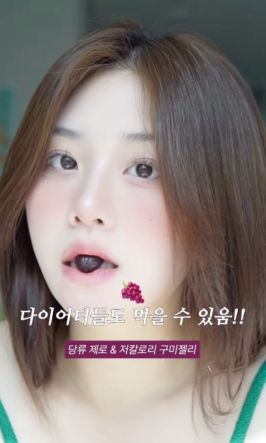](https://www.instagram.com/p/DNnR8SSJaKD/)

[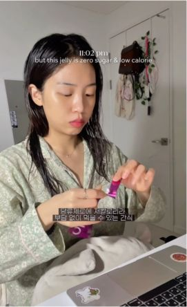](https://www.instagram.com/reel/DNsfsmjZra-/)

**기획의 출발점**  
신규 제품의 인지도와 브랜드 접점을 넓히는 캠페인이었습니다. 2534 여성 타깃을 중심으로 셀럽 PPL, 유가 릴스, 체험단이 함께 운영돼 매체별 콘텐츠 방향과 일정을 맞추는 일이 중요했습니다.

**바꾼 지점**  
인플루언서 규모와 매체 특성에 따라 제품 소구 방식을 나눴습니다. 브랜드가 전달하려는 USP를 유지하면서도, 각 크리에이터의 콘텐츠 안에 자연스럽게 녹아드는 가이드를 준비했습니다.

직접 맡은 일

- 캠페인 목적에 맞는 인플루언서 풀을 제안하고 후보 리스트업
- 매체 특성과 USP를 반영한 콘텐츠 가이드 작성
- 섭외·브리핑·제품 배송·검수·업로드 일정 조율
- 콘텐츠 반응을 실시간 모니터링하고 게재 보고서 작성

**결과**  
유·무가 통합 캠페인에서 누적 조회수 88.8만 회 이상, 인터랙션 3만 건 이상을 기록했습니다. 100인 체험단을 포함한 여러 협업 접점의 진행 상황을 관리해 업로드 완료율 100%를 달성했습니다.

다음 기획에 남긴 기준

한 캠페인 안에서도 크리에이터마다 설명하는 방식과 협업 속도가 다릅니다. 공통으로 지킬 제품 메시지를 정리하고, 실행 과정은 파트너에 맞게 조율했습니다.

---

## 02. 어퓨

### 제품 설명이, 그 사람의 추천처럼 들리도록.

제품의 소구점과 크리에이터의 평소 콘텐츠 사이를 맞췄습니다.

2025.08 · 광고대행사 AE | 후보 제안·가이드·검수·커뮤니케이션 · 기여도 80%

**6명** 마이크로 인플루언서 협업 | **28만+** 누적 조회수 | **100%** 기한 내 업로드 완료율

[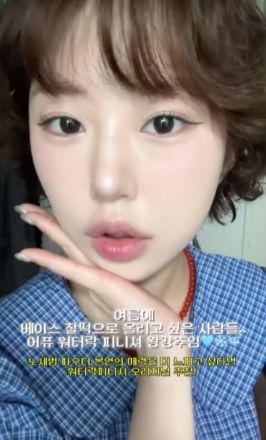](https://www.instagram.com/reel/DNVeMshzfoN/)

[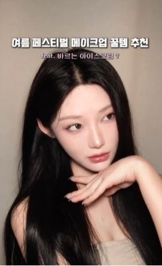](https://www.instagram.com/p/DNarUnRvHpv/)

**기획의 출발점**  
신제품 출시 시점에 1020 여성 타깃의 관심과 인지도를 높이는 과제였습니다. 브랜드 톤을 지키면서 제품의 소구점이 크리에이터의 콘텐츠에서 자연스럽게 드러나도록 해야 했습니다.

**바꾼 지점**  
제품 특성과 타깃의 라이프스타일을 기준으로 후보를 제안했습니다. 일방적인 제품 소개보다 크리에이터의 평소 콘텐츠 흐름 속에서 USP를 보여주는 방향으로 가이드를 구성했습니다.

직접 맡은 일

- 제품 특성·타깃 페르소나를 고려한 인플루언서 풀 제안
- 브랜드 톤과 제품 USP를 반영한 네이티브 콘텐츠 가이드 수립
- 섭외·브리핑·검수·일정 조율 및 문의 대응
- 업로드 현황·반응 지표를 확인하고 게재 보고서 작성

**결과**  
마이크로 인플루언서 6명과의 협업으로 누적 조회수 28만 회 이상을 기록했습니다. 기한 내 업로드 완료율 100%를 달성했습니다.

다음 기획에 남긴 기준

뷰티 콘텐츠의 가이드는 제품 정보를 빠짐없이 적는 것에서 끝나지 않습니다. 어떤 장면과 표현으로 보여줄지까지 정리해야 검수와 제작의 기준이 맞아집니다.

---

## 03. 포토그레이

### 프레임을 알리는 대신, 찍고 싶은 장면을 만들다.

신규 프레임의 사용 장면을 숏폼의 첫인상으로 바꿨습니다.

2025.04–2025.05 · 인하우스 인플루언서 마케팅 | 홍보 방향·릴스 기획 · 기여도 50%

**200만+** 업로드 2주 내 누적 조회수 | **17.2만+** 인터랙션 | **8.6만+** 참여 계정

[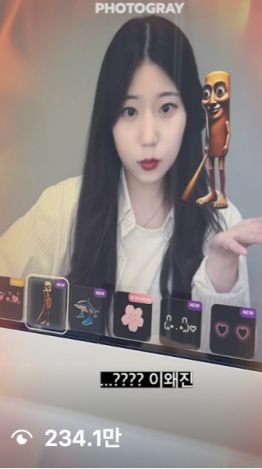](https://www.instagram.com/reel/DI3X_psyEa1/)

[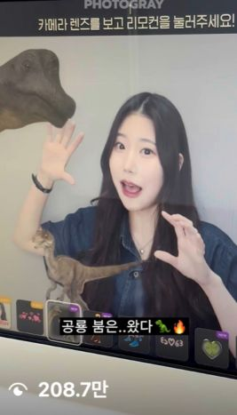](https://www.instagram.com/reel/DJn_NwiSLoM/)

**기획의 출발점**  
신규 프레임의 인지도를 높이고 매장 사용을 유도하는 홍보 과제였습니다. 이미지 피드 중심으로 프레임을 소개하던 방식에서, 실제 적용 모습을 보여줄 수 있는 숏폼으로 접근했습니다.

**바꾼 지점**  
세네컷을 영상 안에 배치해 시선을 끌고, 프레임을 적용한 실제 결과를 보여주는 릴스 방향을 제안했습니다. 타깃이 콘텐츠를 보고 프레임의 사용 장면을 바로 이해할 수 있도록 기획했습니다.

직접 맡은 일

- MZ 타깃의 콘텐츠 소비 패턴을 바탕으로 릴스 홍보 방향 제안
- 신규 프레임의 실제 적용 모습을 보여주는 리얼리티 콘텐츠 기획
- 세네컷 결과물을 활용한 시각적 후킹과 영상 구성 기획

**결과**  
기존 포트폴리오의 집계 기준으로 업로드 2주 내 누적 조회수 200만 회 이상, 인터랙션 17.2만 건 이상, 참여 계정 8.6만 개 이상을 기록했습니다.

다음 기획에 남긴 기준

사용 결과가 분명한 제품은 긴 설명보다 실제 적용 장면이 메시지를 빠르게 전달합니다. 숏폼 기획에서는 제품 정보와 시청자가 보고 싶어 하는 장면의 접점을 찾았습니다.

---

## 04. GS넷비전 · 크리에이터 성장 분석

### 잘된 영상 다음에는, 무엇을 올려야 할까?

조회수의 크기보다, 다음 영상에 쓸 이유를 찾았습니다.

2025.01–2025.04 · 콘텐츠커머스팀 | 채널 분석·리포트·콘텐츠 방향 제안 · 기여도 80%

**550만→1,710만** 채널 조회수 변화 | **약 211%** 조회수 증가율 | **정기 리포트** 분석·피드백 체계 구축

[크리에이터 A · 분석 참여 채널](https://www.youtube.com/channel/UC0kWYJDvhh4bmcnafXn8tgw)

[크리에이터 B · 분석 참여 채널](https://www.youtube.com/channel/UCg_7DlY17asK8O6EJJlKwnA)

**기획의 출발점**  
소속 크리에이터 채널의 양적·질적 성장을 위해 정체 원인을 파악하고 콘텐츠 방향을 제안했습니다. 조회수뿐 아니라 구독자·참여율 등 여러 지표를 함께 살펴야 했습니다.

**바꾼 지점**  
채널별 성장 정체 원인을 구분하고, 크리에이터 특성과 성과 데이터를 함께 고려해 콘텐츠 테마와 소재를 제안했습니다. 분석 결과가 다음 제작에 쓰이도록 정기 피드백 구조를 만들었습니다.

직접 맡은 일

- 크리에이터별 성장 정체 원인 분석과 맞춤 성장 로드맵 기획
- 조회수·구독자·참여율 등 주요 지표 추이 분석 및 리포트 발간
- 데이터와 크리에이터 특성을 결합한 콘텐츠 테마·소재 제안
- 콘텐츠 반응과 타깃 유입 경로 데이터 정리

**결과**  
기존 자료에 기재된 채널 조회수는 550만 회에서 1,710만 회로 증가했습니다. 정기 분석과 콘텐츠 피드백 체계를 마련해 채널 성장에 기여했습니다.

다음 기획에 남긴 기준

같은 조회수라도 크리에이터의 포맷과 타깃에 따라 다음 실행이 달라집니다. 숫자를 보고서에 옮기는 데서 끝내지 않고, 다음에 시도할 주제로 연결했습니다.

---

## 05. 클라우드 논알콜

### 76개의 일상에, 같은 제품을 다르게 담다.

시즌 이슈를 콘텐츠로 옮기고, 76명의 업로드까지 챙겼습니다.

2025.12–2026.01 · 광고대행사 AE | 후보 제안·가이드·섭외·운영·보고 · 기여도 70%

**76명** 나노 인플루언서 협업 | **114만+** 누적 조회수 | **1.4만+** 인터랙션

[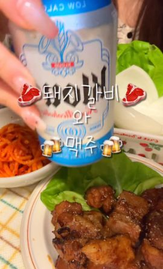](https://www.instagram.com/p/DTqEhmwk3T1/)

[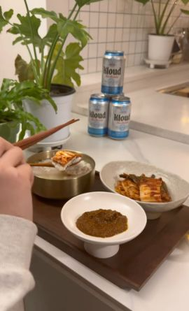](https://www.instagram.com/p/DTChdWeAUct/)

**기획의 출발점**  
신제품 인지도를 높이기 위한 나노 인플루언서 협업 캠페인이었습니다. 여러 파트너의 콘텐츠 방향과 일정을 함께 관리하면서 제품이 타깃의 관심사 안에 등장하도록 해야 했습니다.

**바꾼 지점**  
당시 흑백요리사 시즌2 방영 시점에 맞춰 제품을 음식 콘텐츠와 연결하는 네이티브 가이드를 수립했습니다. 제품 특성과 타깃에 맞는 후보 풀을 제안하고 실행을 조율했습니다.

직접 맡은 일

- 제품 핵심 타깃에 맞는 인플루언서 풀 제안 및 리스트업
- 시즌 이슈를 반영한 네이티브 콘텐츠 가이드 수립
- 인플루언서 76명 섭외·일정 조율·문의 대응
- 업로드 현황 모니터링 및 성과 분석·게재 보고서 작성

**결과**  
나노 인플루언서 76명 협업으로 누적 조회수 114만 회 이상, 인터랙션 1.4만 건 이상을 기록했습니다. 업로드 완료율 100%를 달성했습니다.

다음 기획에 남긴 기준

협업 규모가 커질수록 메시지와 일정의 기준이 분명해야 합니다. 가이드부터 문의 대응, 업로드 확인까지 연결해 캠페인을 마무리했습니다.

---

## 함께 보여줄 경험

### GS25 × NMIXX | 화면에서 만든 기대를, 현장의 경험으로

메인 콘텐츠 기획 참여·촬영 현장 보조·팬덤 참여를 고려한 인터랙티브 콘텐츠 스토리보드 제작.

[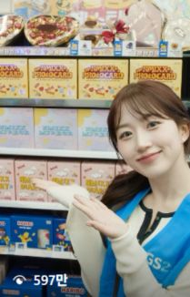](https://www.instagram.com/reel/DGnFblPJbDF/)

[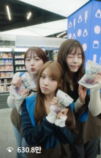](https://www.instagram.com/reel/DGz9ZQ4JdZw/)

[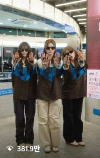](https://www.instagram.com/reel/DGxcEEvpnxa/)

### 총학생회 녹색지대

테마·컬러·슬로건과 시각 아이덴티티, AR 필터 사전 홍보, 반다나 등 굿즈 기획, 현장 운영과 대학 본부 협의를 맡았습니다.

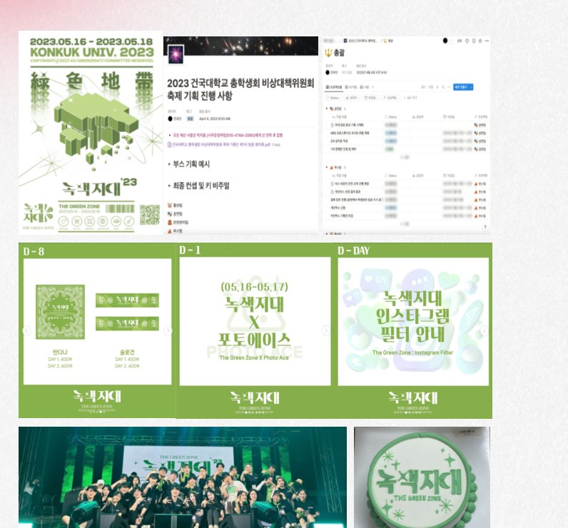

성과는 참여 캠페인·채널의 결과이며 개인 기여도와 구분했습니다. 조회수·인터랙션·참여 계정은 합산하지 않았습니다.
